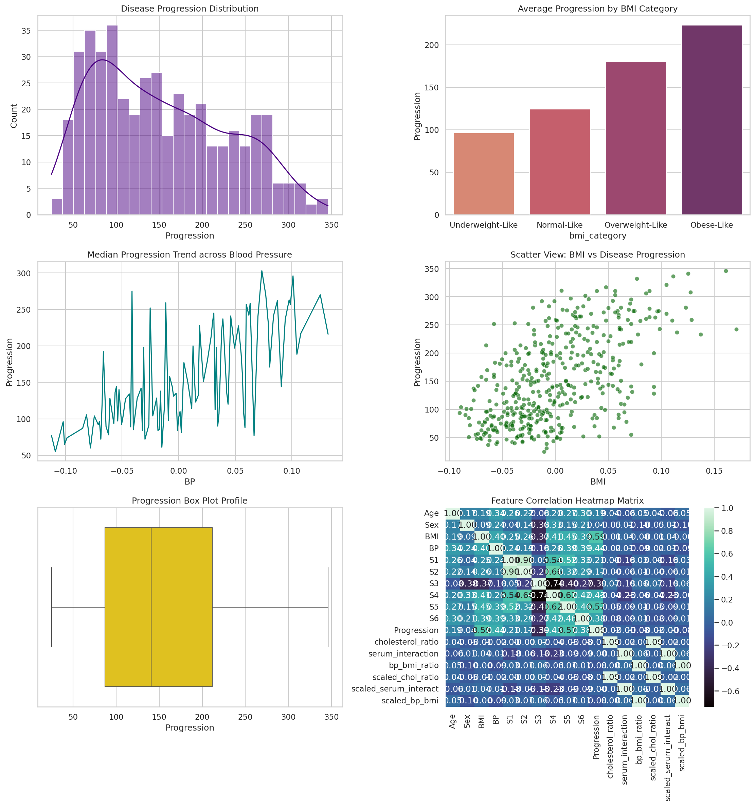

# Clinical Diabetes Analysis: Exploratory Data Processing & Robust Feature Scaling

An end-to-end analytical pipeline designed to decode clinical indicators and engineer robust predictors for tracking diabetes progression.

---

## 📌 Project Overview
This repository provides a step-by-step pipeline demonstrating core data science workflows on the diagnostic **Diabetes Dataset**. The analysis covers raw data validation, exploratory visualization dashboards, interactive scatter/distribution profiles, and advanced robust feature scale modeling.

---

## 🗺️ Pipeline Architecture

### 1. Dataset Collection & Ingestion
* **Database:** Scikit-Learn Diabetes Dataset (442 clinical profiles, 11 quantitative features).
* **Core Objective:** Map clinical characteristics—including age, sex, body mass index (BMI), blood pressure (BP), and six blood serum measurements (S1-S6)—to the target progression metrics of the disease.

### 2. Scientific Computing (NumPy)
Using vector computations directly, key statistical baselines of disease progression were extracted:
* **Average Progression Level:** 152.13
* **Valuation Midpoint (Median):** 140.50
* **Progression Standard Deviation:** 77.01
* **Value Range Floors / Ceilings:** Min 25.00 to Max 346.00
* **Interquartile Metrics:** 25th Percentile at 87.00 | 75th Percentile at 211.50

### 3. Structural Cleaning (Pandas)
* **Sanity Checks:** Verified zero null values and zero duplicated samples across all 442 medical patient profiles, securing solid parameters for feature scaling.

### 4. Principal Analytical Observations
1. **The BMI Influence:** Higher body mass indices closely correlate with elevated progression values (Pearson coefficient: 0.59).
2. **Blood Pressure Trends:** Progression medians rise steadily alongside increases in mean Blood Pressure metric ranges.
3. **Blood Serum Correlatives:** Strong structural relationships exist between total cholesterol (`S1`) and low-density lipoproteins (`S2`) (Pearson coefficient: 0.90).
4. **Outlier Detection:** Box plot assessments show a balanced dispersion of progression parameters without highly skewed anomalies.

---

## 📊 Visualization Dashboards

### Static Exploratory Figures
*(A multi-pane graphical diagnostic layout exploring feature mechanics)*



- **Histogram Profile:** Exhibits progression frequencies with integrated kernel density estimation (KDE).
- **Bar Chart analysis:** Average progression mappings across customized categorical groupings ('Normal-Like', 'Obese-Like' etc).
- **Scatter Relationship:** Illustrates the direct correlation between BMI changes and progression.
- **Correlation Matrix Heatmap:** Exposes positive/negative interactions across all clinical blood serum scores.

### Interactive Dashboards (Plotly)
- **Interactive Histograms:** Real-time bin customization for granular medical value inspection.
- **Interactive Scatter Plots:** Explorable distribution maps displaying Age and Sex variables dynamically on hover.

---

## 🛠️ Feature Engineering & Robust Scaling
Three physical interaction metrics were engineered to represent metabolic indices:
1. **Cholesterol Quotient (`cholesterol_ratio`):** Computes total cholesterol against low-density lipoproteins.
2. **Serum Concentration Interaction (`serum_interaction`):** Captures multi-level interactions between blood markers (`S3` * `S4`).
3. **Circulatory System Ratio (`bp_bmi_ratio`):** Evaluates blood pressure levels directly against BMI values.

*A standard RobustScaler was applied to safeguard models from any extreme value distortions across the newly created dimensions.*

---

## 🚀 Project Portability & Setup

1. **Clone the repository:**
   ```bash
   git clone [https://github.com/vemuriSasi/Data-Preparation-and-analysis-of-Clinical-Diabetes-dataset.git]
   ```

2. **Deploy project dependencies:**
   ```bash
   pip install -r requirements.txt
   ```

3. **Execute Analysis:**
   Launch the notebook in your Jupyter/Colab environment to explore.
